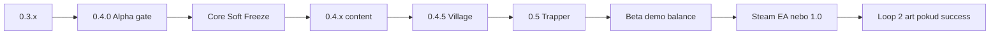

# Projekt LOOP — Product roadmap + cesta na trh

**Účel:** směr vývoje a uvedení na trh — ne implementační ticket.  
**Stav:** Early Alpha (`0.3.x`); veřejné jméno **Alpha** až při dropu **0.4.0**.

Core se má brzy zmrazit; dál hlavně obsah, balance, postavy, terén, artefakty; marketing levně a poctivě.

---

## 1. Politika zmrazení jádra (Core Freeze)

### CORE (po Freezu jen bugfix)

- Grid combat loop (tahy, energie, pohyb, block, statusy, iniciativa)
- Karta → efekt pipeline (až na drobné EffectType přídavky vázané na obsah)
- Mapa runu, shop / reward / rest / event flow
- Struktura vesnice (čísla a texty OK ladit)
- Save / meta schema pravidla

### Smí růst po Freezu

| Oblast | Proč OK |
|--------|---------|
| Karty / rarity / ceny | obsah + balance |
| Artefakty | obsah |
| Terrain (barrel, quicksand, holy ground…) | arena content; `TerrainData` už existuje |
| Nové postavy | mechaniky *uvnitř* existujícího jádra (Trapper pasti) |
| Enemy / encounter / layouty | obsah |
| UI polish, SFX, VFX, animace | polish / artist později |
| Displacement micro-engine (PUSH / PULL / TAUNT) | **Alpha gate MUST** (#53) — výjimka ze soft-freeze „až po 0.4“ |
| Další EffectType po gate | jen pokud odemkne content; pak znovu freeze |

### Soft Freeze bod

**Po dropu Alpha 0.4.0** = Core Soft Freeze.

- Do 0.4: gate issues (#34) + bugy + **#53 displacement** (Taunt / push / pull — owner must před Alphou).
- **0.4.x–0.5:** obsah; další systémové mikro-addy jen výjimečně, pak znovu freeze.
- **1.0 / Steam:** feature freeze → jen crash / blocker + texty.

### Skill tree (#38) — NECOMMITTED

- **Nepočítat** do Beta ani 1.0 jako must-have.
- Zůstává „maybe někdy / uvážení“ — klidně **nikdy**.
- Hra musí stát bez skill tree (karty + artefakty + vesnice + postavy stačí).

### Holy Push + displacement (#53 — gate)

- **Před Alphou:** PUSH / PULL / TAUNT EffectTypes + starter Taunt (0E) + pool push/pull (0E) + Holy Push v poolu.
- #40 holy *ground* zůstává content (`PLACE_TERRAIN`); displacement je oddělený micro-engine v #53.
- Holy Push návrh: HOLY dmg + adjacent push (kolize unit↔unit / rock — tune later).

---

## 2. GitHub issues → fáze

### Teď → Alpha 0.4 gate (#34)

| Issue | Stav | Poznámka |
|-------|------|----------|
| #39 Artefakty rarity ladder | OPEN | musí před 0.4 |
| #40 Paladin holy ground (content) | OPEN | `PLACE_TERRAIN` (ground); push je #53 |
| #53 Taunt / PUSH / PULL | OPEN | **gate MUST** — displacement micro-engine |
| #31 3 GIFy itch/social | OPEN | marketing lite |
| #32 Branding „Alpha“ | OPEN | až při 0.4 dropu |
| #33 QA 3× Paladin run | OPEN | gate |

Hotovo v gate: #25–#30 (+ shop/reward/initiative/artifact UX extras).

Milestone: [Alpha 0.4 gate](https://github.com/Nasshor01/Projekt-Loop/milestone/2)

### Po 0.4 (Mid-Alpha)

| Issue / nápad | Fáze |
|---------------|------|
| #35 Village resource ekonomika | 0.4.5 |
| #36 Village companion | 0.4.5 |
| #37 Trapper plně hratelný + unlock | **0.5** |
| Další village plán (po splitu v2) | [`docs/VILLAGE_PLAN.md`](VILLAGE_PLAN.md) |
| Holy Push + displacement mikro-engine | **přesunuto do gate** (#53) |
| Barrel / quicksand / víc arena terénu | 0.4.x–0.5 |
| Další artefakty / enemy packy | průběžně 0.4.x |

Milestone: [Village / Trapper track](https://github.com/Nasshor01/Projekt-Loop/milestone/3)

### Maybe / parkoviště

| Item | Poznámka |
|------|----------|
| #38 Skill tree | **neplánovat deadline** |
| VFX / sprite animace / human OST | Beta polish pozdě, nebo **Loop 2** po reálném úspěchu |

---

## 3. Etika produktu a „Deluxe“

**Žádný Deluxe / OST / artbook**, dokud to není **lidská** (placená nebo jasně licencovaná) práce.

- Generované assety = OK jako dočasný gameplay art v **Loop 1**.
- **Neprodávat** AI artbook / AI soundtrack jako premium DLC — bez peněz na human work nemá smysl brát peníze za AI work.
- Steam listing: **jedna edice** hry. Cosmetics/deluxe až kdyby existoval reálný OST/art od člověka.

### Loop 1 vs Loop 2

- **Loop 1:** low-cost, funkční art (ModularCards, pixel), minimum outsourcingu.
- **Loop 2** (pokud Steam traction): minimální změny mechanik; artisti, UI, human music, animace — vizuální generace, ne redesign combat core.

---

## 4. Verze (bez skill tree na kritické cestě)

| Verze | Cíl hráče |
|-------|-----------|
| **0.4.0** | Stabilní Paladin Alpha + GIFy + itch |
| **0.4.x** | Obsah (displacement už v gate přes #53) |
| **0.4.5** | Vesnice hloubka |
| **0.5** | Trapper plně hratelný |
| **Beta** | Demo, balance, wishlist — **bez** skill tree musí fungovat |
| **Steam** | Feature freeze |

---

## 5. Cesta na trh (GTM) + finance

### 5.1 Positioning

- **Pitch:** taktický deckbuilder na gridu (STS energie/karty × grid positioning).
- **Hook:** dvě identity — Paladin (linie / holy) vs Trapper (pasti / kite).
- **Kanál 1:** itch.io Alpha (free / PWYW) → komunita.
- **Kanál 2:** Steam page + wishlist před EA.

### 5.2 Cenová strategie (jedna SKU)

| Produkt | Cena | Poznámka |
|---------|------|----------|
| itch Alpha | Free / PWYW | feedback, ne revenue |
| Steam Early Access | **$9.99–12.99** | EA levnější než full STS-like |
| 1.0 launch | **$14.99–19.99** | + launch sleva −10–15 % |
| Deluxe | **ne** | viz etika výše |

Regionální ceny Steam default. Neměnit cenu nahoru bez major content dropu.

### 5.3 Prodeje — kalibrace očekávání

**10k kopií = neskutečný crazy success** pro solo/indie bez publishera — ne barák, ale **peníze na pokračování** (Loop 2 art, time, tools).

| Scénář | Řád kopií / rok 1 | Význam |
|--------|-------------------|--------|
| Tichý | desítky–nízké stovky | učení, portfolio |
| Zdravý indie | stovky–~2k | pokryje čas + Steam fee; pokračovat jde |
| „Here comes the money“ | **~10k+** | runway na Loop 2 / human art/music |
| Viral outlier | 30k+ | neplánovat; bonus |

Plánovat cashflow na **tichý–zdravý**. 10k brát jako jackpot cíl, ne baseline.

### 5.4 Marketing budget (low spend first)

**Fáze 0 — $0 (teď až 0.4)**  
Organika: Reddit, Discord, itch, 3 GIFy (#31), devlog. Žádné ads.

**Fáze 1 — drobné ($0–200)**  
Steam page (Coming Soon). Keys small creatorům. Žádný povinný paid boost.

**Fáze 2 — až page + trailer ($200–1k, jen pokud organika žije)**  

- Steam Next Fest (slot zdarma; budget = čas na demo)
- Mikro-ads jen s měřením wishlist cost — **zastavit**, pokud CPL wishlist > ~$1–2
- 1–2 niche creators (keys > cash)

**Fáze 3 — financování marketingu (předvýzkum, ne nutně dělat)**  

| Zdroj | Realita pro LOOP |
|-------|------------------|
| Vlastní cash z EA | primární |
| Publisher | cut 30–70 %, deadline tlak — až po 0.5+ pokud vůbec |
| Granty (ČR/EU kulturní/herní) | zjistit výzvy; často IČO + reporting |
| Crowdfunding | riziko expectations; spíš po silném demu |
| Influencer paid | drahé; nejdřív organický key |

**Pravidlo:** neutrácej na ads dřív, než máš **stabilní build + Steam page + aspoň organických pár set wishlistů**.

### 5.5 Funnel

1. itch Alpha + feedback (PlayerFeedback ve hře)
2. GIFy / short clip (#31)
3. Steam Coming Soon po 0.4
4. Demo před EA (Paladin loop; teaser Trapper)
5. Next Fest pokud sedí termín
6. Discord + changelog ~1× / 2 týdny v 0.4.x

### 5.6 Nemarketingovat jako hotové

- „Full release“ před feature freeze
- Trapper jako hlavní hrdina před 0.5
- Skill tree
- Deluxe AI OST / artbook

---

## 6. Jednovětné pravidlo

> **0.4 gate → soft-freeze core → obsah a postavy. Skill tree maybe never. Žádný prodej AI deluxe. Marketing nejdřív zadarmo; 10k kopií = jackpot na pokračování, ne baseline.**

---

## 7. Související dokumenty v repu

- [`PLAN_PŘIDÁVÁNÍ_OBSAHU.md`](../PLAN_PŘIDÁVÁNÍ_OBSAHU.md) — starší content plán (lore, Paladin karty); tento roadmap má přednost u fází a freeze
- [`docs/Projekt_LOOP_Vesnice_Ekonomika.html`](Projekt_LOOP_Vesnice_Ekonomika.html) — vesnice, shop ceny, rarity, gold
- GitHub epic #34 — Alpha 0.4 checklist (živý gate)
